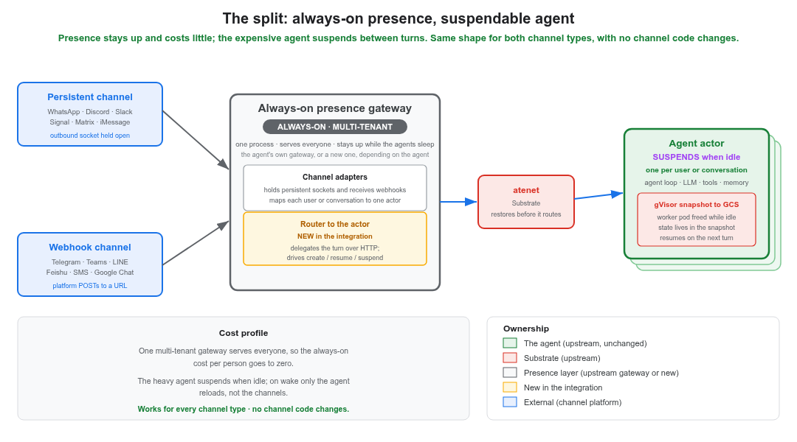
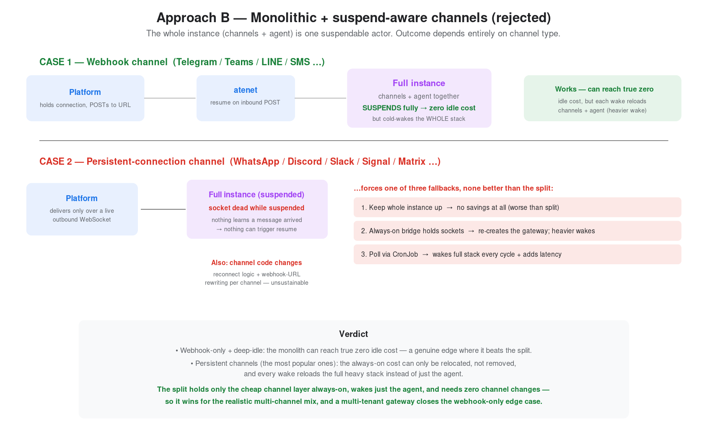

# Always-on agents on Agent Substrate

Reference integrations that run a real agent on [Agent Substrate](https://github.com/agent-substrate/substrate),
one directory each, plus the pattern they share.

The problem each of them solves is the same. A personal-assistant agent is idle
well over 95% of the time, but it has to look online 24/7 for channels like
WhatsApp or Slack. Keeping a machine per agent while it does nothing is what
makes that shape expensive, and it is the cost that stops anyone running a large
fleet of them.

## The pattern

**Split presence from cognition.** An always-on gateway holds the channel
connections and stays cheap. The expensive part, the agent itself, runs as a
suspendable Substrate actor. The gateway suspends it once the conversation goes
idle, and the next inbound message resumes it on demand with its conversation
state intact.

The alternative is to suspend the whole instance, channels included.

That reaches true zero idle cost for channels where the platform holds the
connection and posts each message, which is a genuine edge. It falls over for
channels that hold a persistent socket: a suspended instance has a dead socket,
so nothing ever learns a message arrived and nothing triggers the resume. The
fallbacks all either keep the instance up, re-create the gateway under another
name, or poll. It also needs per-channel code changes, which is the maintenance
problem the split avoids.

Every integration here takes the split for socket-based channels. Where an agent
exposes an HTTP API of its own, the inbound request can drive the resume
directly and no presence layer is needed for that channel at all. The reasoning
in full, with the measurements behind it, is in each integration's own
architecture doc.

## What is in here

| Directory | What |
|---|---|
| [`openclaw/`](openclaw/README.md) | [OpenClaw](https://github.com/openclaw/openclaw) personal AI assistant on GKE: a drop-in plugin, the Kubernetes manifests, the image builds and a WhatsApp demo |
| `docs/` | The two approach diagrams above, which are shared rather than belonging to any one integration |

Each integration directory is self-contained. Everything it needs to build and
deploy lives inside it, and the commands in its README are run from there.

## Adding one

Read [`CONTRIBUTING.md`](CONTRIBUTING.md) first. In short: a new integration is a
new top-level directory with its own README, and what it shares with the others
is the pattern rather than the code.

## Governance

Who maintains this and under what rules is in [`MAINTAINERS.md`](MAINTAINERS.md).
This repository follows the project
[Governance](https://github.com/agent-substrate/substrate/blob/main/GOVERNANCE.md)
and the conventions in
[`docs/integration-repos.md`](https://github.com/agent-substrate/substrate/blob/main/docs/integration-repos.md),
rather than defining its own.

Nothing here is a patch against Substrate. When an integration needs something
the control plane does not do, the core change lands upstream first.

## License

Apache License 2.0. See [`LICENSE`](LICENSE).

## Trademarks

The agents integrated here are independent open-source projects and are not
affiliated with, sponsored by, or endorsed by this repository or its maintainers.
Their names and logos are the property of their respective owners and are used
only descriptively, to identify the software being integrated. Per-project
trademark notices are in each integration's README.
